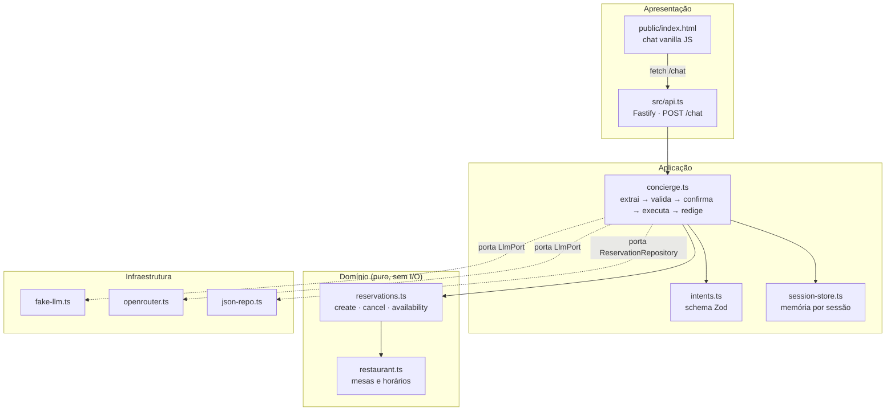

# Mesa Fácil

Mesa Fácil é um concierge de reservas de restaurante que conversa em linguagem natural: o cliente escreve como faria com um atendente humano ("quero reservar mesa pra 4 pessoas sexta às 20h") e o sistema extrai os dados, confirma antes de gravar, aloca a menor mesa disponível, sugere horários alternativos quando está lotado e sabe cancelar ou consultar disponibilidade — tudo isso guardando as informações que o usuário vai completando aos poucos ao longo da conversa. O ponto central do projeto é arquitetural: o LLM **nunca** decide uma regra de negócio, ele só classifica a intenção do usuário (em JSON validado com Zod) e, no fim, redige a resposta em tom simpático; toda a lógica de alocação de mesas, horários, cancelamento e validação é código determinístico, testável sem qualquer chamada de rede.

## O que tem no projeto

| Camada / Item | Tecnologia | Papel |
| --- | --- | --- |
| Linguagem | TypeScript (strict, ESM) | Tipagem em todas as camadas, `tsc --noEmit` como gate de qualidade |
| Runtime | Node.js >= 20 | `engines` no `package.json`; CI roda em Node 22 |
| API HTTP | Fastify | Único endpoint `POST /chat` + serve a página de chat |
| Validação | Zod | Contrato de saída do LLM (`Intent`) e do corpo da requisição HTTP |
| LLM (produção) | OpenRouter (`src/infrastructure/openrouter.ts`) | Extrai intenção e redige respostas via API real, atrás de uma porta |
| LLM (offline/dev) | FakeLlm (`src/infrastructure/fake-llm.ts`) | Heurísticas por regex/palavra-chave, zero rede — usado por padrão e em todos os testes |
| Persistência | JSON em disco (`src/infrastructure/json-repo.ts`) | Sem banco de dados: um arquivo `data/reservations.json` |
| Testes | Vitest | 100% offline — `npm test` não faz nenhuma chamada de rede |
| Front-end | HTML + CSS vanilla + `fetch` | Uma página de chat mínima em `public/index.html`, sem build step |

### Estrutura

```
src/
  domain/
    restaurant.ts     # mesas (8x2, 8x4, 4x6) e horários — puro
    reservations.ts   # create/cancel/availability — puro
  application/
    intents.ts         # schema Zod da saída do LLM
    outcomes.ts         # tipos do resultado de cada turno do concierge
    ports.ts             # interfaces LlmPort e ReservationRepository
    session-store.ts   # memória da conversa por sessão
    concierge.ts        # pipeline: extrai -> valida -> confirma -> executa -> redige
  infrastructure/
    fake-llm.ts        # LLM offline (heurístico)
    openrouter.ts       # LLM real via OpenRouter
    json-repo.ts        # persistência em arquivo JSON
  api.ts                # Fastify + composition root
public/
  index.html            # chat mínimo (HTML/CSS/JS vanilla)
tests/
  domain/, application/, infrastructure/, api.test.ts
  helpers/               # dublês de teste (ScriptedLlm, repositório em memória)
```

## Arquitetura



A seta pontilhada marca as **portas** (interfaces definidas em `src/application/ports.ts`): o `concierge.ts` nunca importa `fake-llm.ts` ou `openrouter.ts` diretamente — quem decide qual adaptador usar é a composition root em `src/api.ts`, a partir da variável de ambiente `LLM`.

## Como rodar

Pré-requisitos: Node.js >= 20.

```bash
npm install
cp .env.example .env       # ajuste se quiser usar LLM=openrouter
npm run dev                # ou: npm start
```

Abra `http://localhost:3000` para o chat, ou fale com a API diretamente:

```bash
curl -X POST http://localhost:3000/chat \
  -H "Content-Type: application/json" \
  -d '{"sessionId":"abc","message":"quero reservar mesa pra 2026-08-20 as 20:00, 4 pessoas, nome Carla"}'
```

Por padrão (`LLM=fake`), tudo roda offline, sem chave de API. Para usar um LLM de verdade, defina `LLM=openrouter` e `OPENROUTER_API_KEY` no `.env`.

## Como testar

```bash
npm test          # vitest run — 100% offline, nenhuma chamada de rede real
npm run typecheck # tsc --noEmit
```

A suíte tem 45 testes em 8 arquivos, cobrindo:

- **Domínio** (`tests/domain`): alocação da menor mesa que comporta o grupo, rejeição de data passada e de horário inválido, orientação por telefone para grupos de 7+, sugestão dos 2 horários livres mais próximos quando o slot pedido está lotado, cancelamento (existente e inexistente) e listagem de disponibilidade.
- **Aplicação** (`tests/application`): schema de intenção (intenção desconhecida cai em `other`, payload malformado é rejeitado) e o pipeline do concierge — caminho feliz com confirmação em duas etapas, preenchimento gradual de entidades entre turnos, dois erros seguidos de JSON inválido caindo no fallback fixo sem exceção, entidade faltante gerando pergunta específica sem executar a regra, cancelamento inexistente com resposta educada, e uma falha do próprio `renderReply` caindo em um texto determinístico (nunca finge sucesso).
- **Infraestrutura** (`tests/infrastructure`): heurísticas do `FakeLlm`, o adaptador `OpenRouterLlm` com `fetch` mockado (sem rede real) e o `JsonReservationRepository` lendo/escrevendo em um arquivo temporário.
- **API** (`tests/api.test.ts`): `POST /chat` fim a fim usando `FakeLlm` e um repositório em memória, via `app.inject` do Fastify (sem subir servidor de verdade).

O double do LLM usado nos testes de aplicação (`ScriptedLlm`, em `tests/helpers`) responde com um roteiro fixo de strings/erros por chamada — é assim que os cenários de "JSON inválido duas vezes" e "erro na segunda tentativa" são simulados sem precisar de rede.

## Variáveis de ambiente

Veja `.env.example`:

| Variável | Obrigatória? | Descrição |
| --- | --- | --- |
| `LLM` | não (padrão `fake`) | `fake` (offline) ou `openrouter` (API real) |
| `OPENROUTER_API_KEY` | só se `LLM=openrouter` | chave da [OpenRouter](https://openrouter.ai/keys) |
| `OPENROUTER_MODEL` | não | modelo da OpenRouter (padrão `openai/gpt-4o-mini`) |
| `PORT` | não (padrão `3000`) | porta HTTP do Fastify |
| `DATA_FILE` | não (padrão `./data/reservations.json`) | caminho do arquivo JSON de persistência |

## Transcript de exemplo

Conversa real, rodada localmente com `LLM=fake` (sem nenhuma chave de API), mostrando o usuário completando os dados aos poucos e a confirmação antes de gravar:

```
Usuário: oi, quero reservar uma mesa
Mesa Fácil: Para qual data?

Usuário: 2026-08-20
Mesa Fácil: Para qual horário (entre 18:00 e 22:00)?

Usuário: as 20:00
Mesa Fácil: Para quantas pessoas?

Usuário: 4 pessoas
Mesa Fácil: Em nome de quem fica a reserva?

Usuário: nome Carla
Mesa Fácil: Posso confirmar: 4 pessoa(s) em 2026-08-20 às 20:00, em nome de Carla? (sim/não)

Usuário: sim
Mesa Fácil: Prontinho! Reserva confirmada para Carla, 2026-08-20 às 20:00. Até lá!
```

Repare que nenhuma das mensagens intermediárias repete a palavra "reservar" — a sessão em memória (`pendingIntent` em `SessionState`) mantém o fio da conversa, e só a última mensagem ("sim") de fato aciona a gravação da reserva via `createReservation()`.

## Limitações conhecidas

- O modo `LLM=fake` entende datas em `YYYY-MM-DD`, `dd/mm/aaaa`, "hoje" e "amanhã" — mas não interpreta dias da semana ("sexta", "terça que vem"), pois isso exige compreensão real de linguagem natural (papel do `LLM=openrouter`, não do heurístico offline).
- `JsonReservationRepository` não tem lock de concorrência: adequado para um projeto de portfólio/demonstração, não para múltiplas instâncias escrevendo ao mesmo tempo.
- A sessão de conversa é guardada em memória por processo (não sobrevive a um restart do servidor nem escala horizontalmente).

## Origem

Este projeto foi inspirado em conceitos do curso de pós Engenharia de Software com IA Aplicada — implementação própria do zero.

## Licença

MIT — veja [LICENSE](./LICENSE).
